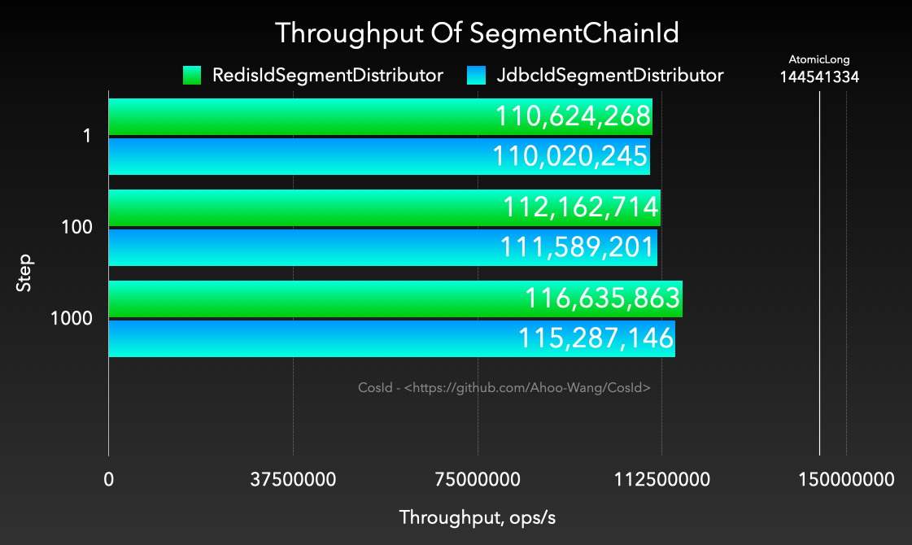
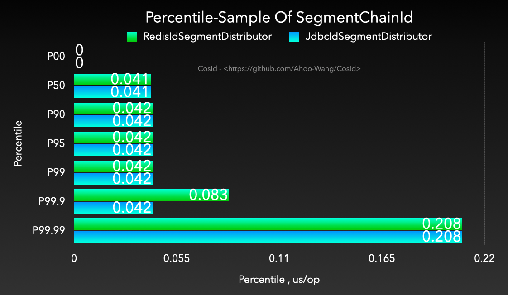

<p align="center" style="text-align:center">
  
</p>

# [CosId](https://cosid.ahoo.me/) Universal, flexible, high-performance distributed ID generator

[](https://www.apache.org/licenses/LICENSE-2.0.html)
[](https://github.com/Ahoo-Wang/CosId/releases)
[](https://central.sonatype.com/artifact/me.ahoo.cosid/cosid-core)
[](https://app.codacy.com/gh/Ahoo-Wang/CosId?utm_source=github.com&utm_medium=referral&utm_content=Ahoo-Wang/CosId&utm_campaign=Badge_Grade_Settings)
[](https://codecov.io/gh/Ahoo-Wang/CosId)

<a href="https://atomgit.com/Ahoo-Wang/CosId"></a>

> [中文文档](https://cosid.ahoo.me/zh/) | [English Document](https://cosid.ahoo.me/)

Every replica of a service needs IDs (primary keys, order numbers, event ids) that never collide with those of the other replicas. *CosId* generates them inside your process, without a network call per ID, and does the coordination that keeps them unique: it leases a distinct machine id to every Snowflake instance from a store you already run, takes ranges of segment IDs ahead of time, and handles clocks that move backwards.

| Generator | ID | Throughput on one instance (historical JMH) | Pick it when |
|-----------|----|---------------------------:|--------------|
| `SegmentChainId` | `long`, near-sequential | 127,439,148 ops/s | You want short numeric keys or business numbers. The default segment mode |
| `SnowflakeId` | `long`, time-ordered | 4,096,000 ops/s (theoretical maximum) | IDs should carry their creation time, with no store call after startup |
| `CosIdGenerator` | `String`, 15 characters, time-ordered | — | You run very many instances (up to a million machine ids) |

Stores: Redis, JDBC (MySQL, MariaDB, PostgreSQL), MongoDB, ZooKeeper, the CosId proxy, or your own. Integrations: Spring Boot, MyBatis, Spring Data JDBC, Jackson, ShardingSphere, Activiti, Flowable and Axon.

## Version compatibility

| CosId | Spring Boot | Java | Branch |
|-------|-------------|------|--------|
| 4.x | 4.x | 17+ | `main` |
| 3.x | 4.x | 17+ | `3.x` (maintenance) |
| 2.x | 3.x | 17+ | `2.x` |
| 1.x | 2.x | 8+ | `1.x` |

Upgrading from 3.x: see [MIGRATION-4.0.md](./docs/MIGRATION-4.0.md).

## Quick start

```kotlin
dependencies {
    implementation(platform("me.ahoo.cosid:cosid-bom:$cosidVersion"))
    implementation("me.ahoo.cosid:cosid-spring-boot-starter")
    implementation("me.ahoo.cosid:cosid-spring-redis") // or cosid-jdbc, cosid-mongo, cosid-zookeeper, cosid-proxy
    implementation("org.springframework.boot:spring-boot-starter-data-redis")
}
```

```yaml
cosid:
  namespace: ${spring.application.name}
  segment:
    enabled: true
    distributor:
      type: redis
    provider:
      order:
        step: 100
```

```java
long orderId = idGeneratorProvider.getRequired("order", IdGenerator.class).generate();
```

The [Getting Started](https://cosid.ahoo.me/guide/getting-started.html) guide walks through it, including Snowflake IDs and Maven.

## Documentation

- [Why CosId](https://cosid.ahoo.me/guide/introduction.html): the problem and the trade-offs between the generators.
- [Core concepts](https://cosid.ahoo.me/guide/concepts/id-generator.html): generators, [machine ids](https://cosid.ahoo.me/guide/concepts/machine-id.html), segments and converters.
- [Choosing a backend](https://cosid.ahoo.me/guide/backends/): Redis, JDBC, MongoDB, ZooKeeper and the proxy.
- [Configuration reference](https://cosid.ahoo.me/reference/config/basic.html): every property and its default.
- [Operations](https://cosid.ahoo.me/guide/operations/production.html): production checklist, rolling upgrades, monitoring and troubleshooting.
- [Migrating to 4.0](https://cosid.ahoo.me/guide/migration/4.0.html), and the full [migration guide](./docs/MIGRATION-4.0.md).

The [examples](./examples) are runnable applications for Redis, ZooKeeper, the proxy and `CosIdGenerator`.

## Performance

Historical [JMH benchmarks](https://cosid.ahoo.me/reference/performance/benchmark.html) on one development notebook (MacBook Pro M1, Redis on the same machine):

<p align="center">
  
</p>

<p align="center">
  
</p>

`SegmentChainId` is about five times as fast as Meituan Leaf's segment mode, see [CosId VS Leaf](https://cosid.ahoo.me/reference/performance/cosid-vs-leaf.html).

## Contributing

Bug reports, ideas and pull requests are welcome. Read [CONTRIBUTING.md](./CONTRIBUTING.md) for the development setup, commit conventions, review and release process, and [SECURITY.md](./SECURITY.md) to report a vulnerability privately. The planned work is in the [roadmap](./docs/ROADMAP.md).

## Community Partners and Sponsors

<a href="https://www.jetbrains.com/?from=CosId" target="_blank">
    
</a>
