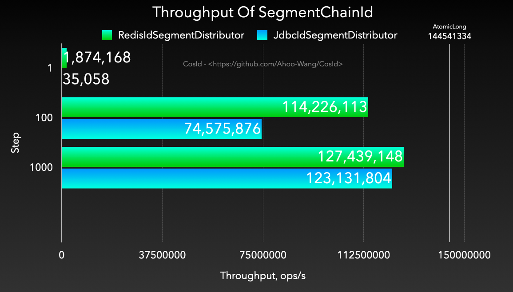

<p align="center" style="text-align:center">
  
</p>

# [CosId](https://cosid.ahoo.me/zh/) 通用、灵活、高性能分布式 ID 生成器

[](https://www.apache.org/licenses/LICENSE-2.0.html)
[](https://github.com/Ahoo-Wang/CosId/releases)
[](https://central.sonatype.com/artifact/me.ahoo.cosid/cosid-core)
[](https://app.codacy.com/gh/Ahoo-Wang/CosId?utm_source=github.com&utm_medium=referral&utm_content=Ahoo-Wang/CosId&utm_campaign=Badge_Grade_Settings)
[](https://codecov.io/gh/Ahoo-Wang/CosId)

[](https://deepwiki.com/Ahoo-Wang/CosId)

> [中文文档](https://cosid.ahoo.me/zh/) | [English Document](https://cosid.ahoo.me/)

服务的每个副本都需要生成 ID（主键、订单号、事件 ID），并且不能与其他副本的 ID 冲突。*CosId* 在应用进程内生成这样的 ID，每个 ID 都不需要网络调用，并替你完成保证唯一所需的协调：从你已有的存储为每个 Snowflake 实例租用不同的机器号，提前获取号段，并处理时钟回拨。

| 生成器 | ID | 单实例吞吐量 | 适用场景 |
|--------|----|-------------:|----------|
| `SegmentChainId` | `long`，接近连续 | 127,439,148 ops/s | 需要较短的数字主键或业务编号。号段的默认模式 |
| `SnowflakeId` | `long`，按时间有序 | 4,096,000 ops/s | ID 需要携带生成时间，启动后不再依赖存储 |
| `CosIdGenerator` | `String`，15 个字符，按时间有序 | 15,570,085 ops/s | 实例数量非常多（最多约一百万个机器号） |

存储：Redis、JDBC（MySQL、MariaDB、PostgreSQL）、MongoDB、ZooKeeper、CosId Proxy，或自定义存储。集成：Spring Boot、MyBatis、Spring Data JDBC、Jackson、ShardingSphere、Activiti、Flowable 和 Axon。

## 版本兼容性

| CosId | Spring Boot | Java | 分支 |
|-------|-------------|------|------|
| 4.x | 4.x | 17+ | `main` |
| 3.x | 4.x | 17+ | `3.x`（维护中） |
| 2.x | 3.x | 17+ | `2.x` |
| 1.x | 2.x | 8+ | `1.x` |

从 3.x 升级：见 [MIGRATION-4.0.md](./docs/MIGRATION-4.0.md)。

## 快速开始

```kotlin
dependencies {
    implementation(platform("me.ahoo.cosid:cosid-bom:$cosidVersion"))
    implementation("me.ahoo.cosid:cosid-spring-boot-starter")
    implementation("me.ahoo.cosid:cosid-spring-redis") // 或 cosid-jdbc、cosid-mongo、cosid-zookeeper、cosid-proxy
    implementation("org.springframework.boot:spring-boot-starter-data-redis")
}
```

```yaml
cosid:
  namespace: ${spring.application.name}
  segment:
    enabled: true
    distributor:
      type: redis
    provider:
      order:
        step: 100
```

```java
long orderId = idGeneratorProvider.getRequired("order", IdGenerator.class).generate();
```

完整步骤（包括 Snowflake ID 和 Maven）见[快速上手](https://cosid.ahoo.me/zh/guide/getting-started.html)。

## 文档

- [为什么需要 CosId](https://cosid.ahoo.me/zh/guide/introduction.html)：要解决的问题，以及各生成器之间的取舍。
- [核心概念](https://cosid.ahoo.me/zh/guide/concepts/id-generator.html)：生成器、[机器号](https://cosid.ahoo.me/zh/guide/concepts/machine-id.html)、号段与转换器。
- [选择后端](https://cosid.ahoo.me/zh/guide/backends/)：Redis、JDBC、MongoDB、ZooKeeper 和 Proxy。
- [配置参考](https://cosid.ahoo.me/zh/reference/config/basic.html)：所有属性及其默认值。
- [运维](https://cosid.ahoo.me/zh/guide/operations/production.html)：生产环境清单、滚动升级、监控与故障排查。
- [迁移到 4.0](https://cosid.ahoo.me/zh/guide/migration/4.0.html)，以及完整的[迁移指南](./docs/MIGRATION-4.0.md)（英文）。

[示例](./examples)是可直接运行的 Redis、ZooKeeper、Proxy 和 `CosIdGenerator` 应用。

## 性能

在一台开发笔记本（MacBook Pro M1，Redis 部署在同一台机器上）上运行的 [JMH 基准测试](https://cosid.ahoo.me/zh/reference/performance/benchmark.html)：

<p align="center">
  
</p>

<p align="center">
  
</p>

`SegmentChainId` 的速度约为美团 Leaf 号段模式的五倍，见 [CosId VS 美团 Leaf](https://cosid.ahoo.me/zh/reference/performance/cosid-vs-leaf.html)。

## 参与贡献

欢迎提交问题、建议和 Pull Request。开发环境、提交规范、代码评审与发布流程见 [CONTRIBUTING.md](./CONTRIBUTING.md)；安全漏洞请按 [SECURITY.md](./SECURITY.md) 私下报告；后续规划见[路线图](./docs/ROADMAP.md)。

## 社区合作伙伴与赞助商

<a href="https://www.jetbrains.com/?from=CosId" target="_blank">
    
</a>
