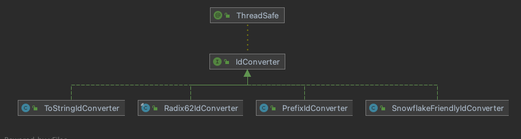

# ID Converters

An `IdConverter` turns a `long` ID into a string and back. `IdGenerator.generateAsString()` uses the generator's converter, so the same generator can produce numeric primary keys and formatted business numbers.

```java
public interface IdConverter {
    String asString(long id);

    default String asString(long id, GroupedKey group) {
        return asString(id);
    }

    default String asString(GroupedId groupedId) {
        return asString(groupedId.getValue(), groupedId.getGroup());
    }

    long asLong(String idString);
}
```

<p align="center">
  
</p>

## Base converters

| Converter | `converter.type` | Output | Notes |
|-----------|------------------|--------|-------|
| `ToStringIdConverter` | `to_string` | Decimal, `12345` | `to-string.pad-start` pads with `0` to `to-string.char-size` |
| `Radix62IdConverter` | `radix` (the starter's default) | `0-9A-Za-z`, at most 11 characters | Case sensitive; `radix.pad-start` (default `true`) pads to `radix.char-size` (default `11`) so strings sort like the numbers |
| `Radix36IdConverter` | `radix36` | `0-9A-Z`, at most 13 characters | Case insensitive; `radix36.pad-start` (default `true`), `radix36.char-size` (default `13`) |
| `SnowflakeFriendlyIdConverter` | `snowflake_friendly` | `20210623131730192-1-0` | Snowflake IDs only: timestamp in `cosid.snowflake.zone-id`, machine id, sequence |
| your own class | `custom` | | `custom.type`: an `IdConverter` class with a public no-argument constructor |

## Decorators

Decorators wrap a base converter and add text around it. The starter applies them in this order, inside out: group prefix and date prefix (when `before-prefix` is `true`, the default), `prefix`, group prefix and date prefix (when `before-prefix` is `false`), then `suffix`.

| Converter | Property | Output |
|-----------|----------|--------|
| `PrefixIdConverter` | `prefix: BIZ-` | `BIZ-12345` |
| `SuffixIdConverter` | `suffix: -BIZ` | `12345-BIZ` |
| `DatePrefixIdConverter` | `date-prefix.enabled: true`, `pattern` (default `yyMMdd`), `delimiter` (default `-`) | `260101-12345`, the date of generation |
| `GroupedPrefixIdConverter` | `group-prefix.enabled: true`, `delimiter` (default `-`) | `20260101-12345`, the [group](./segment.md#grouped-segments) of a grouped segment ID |

A group prefix needs a grouped segment ID (`group.by`): the starter fails at startup if it is enabled on a generator without a group, and `asString(long)` without a group throws `UnsupportedOperationException`.

## Example

```yaml
cosid:
  segment:
    enabled: true
    provider:
      order_no:
        converter:
          type: to_string
          prefix: ORD
          to-string:
            pad-start: true
            char-size: 10
```

`generateAsString()` then returns `ORD0000000001`, and `asLong("ORD0000000001")` returns `1`. [ID recipes](../recipes.md) has a ready configuration for each common format.
