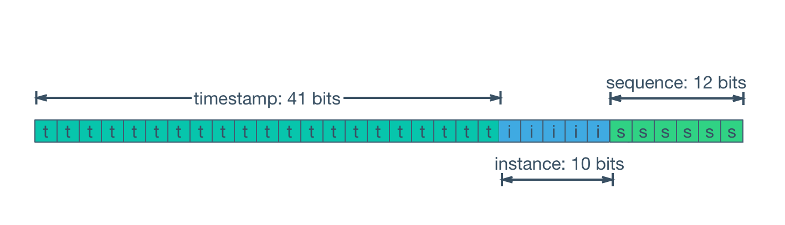

# Layouts and Codecs

A CosId generator produces a number; a **codec** turns it into text. The two are separate (generation never knows
about encoding), so wrapping or counting a generator can never change its text form.

```java
@FunctionalInterface
public interface IdGenerator { long generate(); }

public interface IdCodec {
    String encode(long id);
    long decode(String text);
    default IdCodec withPrefix(String prefix) { ... }
    default IdCodec withSuffix(String suffix) { ... }
}

public record StringIdGenerator(IdGenerator ids, IdCodec codec) {
    public String generate() { return codec.encode(ids.generate()); }
}
```

## Layout: the bits of a time-based id

`Layout` is the one place of the bit arithmetic of Snowflake-style ids: `time | node | seq` from the high bits down.

<p align="center"></p>

```java
public record Layout(Instant epoch, ChronoUnit unit, int timeBits, int nodeBits, int seqBits, long seqResetThreshold) {
    public long pack(long time, int node, long seq);
    public IdParts unpack(long id);          // IdParts(time, node, seq); parts.instant(layout) is the time
    public int totalBits();
    public boolean isJsSafe();               // totalBits <= 53
    public static boolean isJsSafe(long id);
    public Layout withNodeBits(int nodeBits);
}
```

| Preset | Epoch | Unit | time / node / seq | Total | Notes |
|---|---|---|---|---|---|
| `SNOWFLAKE_MS` (default) | 2019-12-24T16:00:00Z (`1577203200000`) | ms | 41 / 10 / 12 | 63 | the 4.x default (D16): ids stay numerically continuous after a migration |
| `SNOWFLAKE_S` | the same | s | 31 / 10 / 22 | 63 | |
| `JS_SAFE_MS` | the same | ms | 41 / 3 / 9 | 53 | fits a JavaScript `number`; at most 8 slots |
| `JS_SAFE_S` | the same | s | 31 / 3 / 19 | 53 | |
| `COSID_80` | Unix epoch | ms | 44 / 20 / 16 | 80 | the 80-bit CosId: text only, through a `PartsCodec` |

- A layout is validated when built: time 1–63 bits, node 0–31, sequence 1–62, unit `MILLIS` or `SECONDS` (a seconds
  epoch is a whole second).
- **The node bits must hold the machine slot.** A time-based generator issues with the slot of its machine (the default
  one, or a [named machine](slot-lease.md#named-machines)), and its node is `slot-offset + slot`; start-up fails unless
  `slot-offset + 2^bits ≤ 2^nodeBits` for every time-based generator. `JS_SAFE_*` (3 node bits) therefore needs
  `machine.leased.bits: 3` or less.
- `seqResetThreshold` keeps the 4.x low-bit scattering: a new time unit starts its sequence at a value up to the
  threshold (half the range by default), so ids modulo a small number spread evenly.
- In Spring, `layout` names a preset and `epoch`, `unit`, `time-bits`, `node-bits`, `seq-bits`, `seq-reset-threshold` override its fields.
  A `cosid80` generator takes only `COSID_80` and its bit widths and threshold: its epoch is the Unix epoch and its unit
  milliseconds, and its time and sequence bits fit a `long` together (D36).

### TimeBasedGenerator

One class issues every time-based id, for any layout; 4.x had a class per unit and per encoding, plus decorators.

```java
public final class TimeBasedGenerator implements IdGenerator, PartsIdGenerator, AutoCloseable {
    public long generate();            // layouts of at most 63 bits
    public IdParts nextParts();        // any layout, COSID_80 included
    public Layout layout();
    public int slot();
    public long lastIssuedMillis();
}
```

Issuing an id is a short critical section: read the time, check it against the slot's window, advance the sequence.
**Every wait happens outside the lock** (the first id after a new slot, an exhausted sequence, a clock regression),
which kept 5.0 on par with 4.x at 16 threads (D25).

### Clock regression

`ClockRegressionPolicy(borrowUpTo, waitUpTo)`, default `5ms` / `1s`:

| The clock went back by | The generator |
|---|---|
| at most `borrowUpTo` | keeps issuing on the last time unit ("borrows" the future) |
| at most `waitUpTo` | waits for the clock to catch up |
| more | throws `ClockBackwardsException` |

`ClockRegressionPolicy.FAIL` fails at once. None of this affects uniqueness across instances: that is the job of the
[slot lease](slot-lease.md)'s window.

## Codecs

| Codec | Text | Notes |
|---|---|---|
| `Radix.of(radix, width, padStart)` | base 2–62 | one class for base 10, 36 and 62; `decode` checks overflow. `Radix.of(62, 11, true)` is 4.x's `Radix62IdConverter.PAD_START` |
| `Friendly.of(layout, zone, padStart)` | `yyyyMMddHHmmssSSS-node-seq` | time-based ids; the zone is always explicit; `padStart` pads node and sequence to their widths |
| `withPrefix`, `withSuffix` | `O` + text | |
| `DatePrefix.of(pattern, delimiter, source)` | `20261027-` + text | `source = ID_TIME` (the id's own time, time-based only) or `NOW` (the clock, as 4.x segments did) |
| `PartsCodec.radix(layout, radix)`, `PartsCodec.friendly(layout, zone)` | 80-bit CosId text | each part at a fixed width, so the text sorts like the id |
| `GroupedCodec.datePrefix(delimiter, valueCodec)` | `20261027-000042` | periodic segments: the period, then the value |
| your own `IdCodec` | | named by class name or bean name (`custom`) |

In configuration a codec is an **ordered list**, applied in the order written. The first item turns the id into text
(`radix`, `friendly` or `custom`); without one the text is decimal. The items after it (`prefix`, `suffix`,
`date-prefix`) wrap it:

```yaml
cosid:
  generators:
    order:
      strategy: segment
      store: db
      codec:
        - radix: { radix: 62 }                     # 1. base 62
        - date-prefix: { pattern: yyMMdd, delimiter: "", source: NOW }   # 2. 261027qZ
        - prefix: "O"                              # 3. O261027qZ
    trace:
      strategy: snowflake
      codec:
        - friendly: { zone: Asia/Shanghai }        # 20261027153012123-0003-0017
    token:
      strategy: cosid80
      codec:
        - radix: { radix: 62 }                     # one radix or friendly item
```

Every codec decodes as well: `codec.decode(text)` returns the id, and `layout.unpack(id)` its parts, which replaces the
4.x `SnowflakeIdStateParser`.

## Small helpers

`IdGenerators` composes the rest, in place of the 4.x classes:

| 4.x | 5.0 |
|---|---|
| `IntegerIdGenerator` | `IdGenerators.toInt(ids)`: an `IntIdGenerator`, `IdOverflowException` past `Integer.MAX_VALUE` |
| `UncertaintyIdGenerator` | `IdGenerators.uncertain(ids, bits, random)` |
| `AtomicLongGenerator`, `UuidGenerator` | `IdGenerators.local()`, `IdGenerators.uuid()` |
| `LazyIdGenerator` | `IdGenerators.lazy(() -> runtime.generator("order"))` |
| `SafeJavaScriptSnowflakeId` | `Layout.JS_SAFE_MS` / `JS_SAFE_S` |
