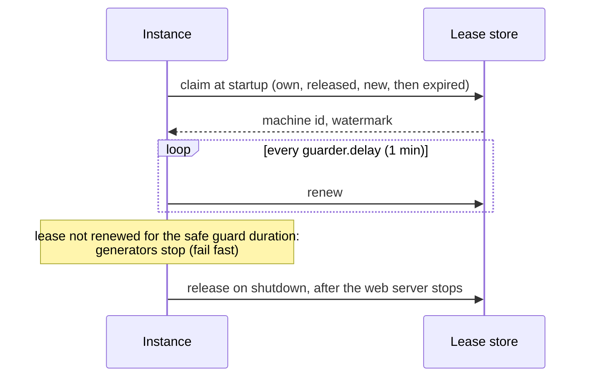

# Machine ID

A *machine id* is the worker-id field of a [Snowflake ID](./snowflake.md) (and of a [CosIdGenerator](./cosid-generator.md) ID). Two instances that generate IDs with the same machine id at the same time can generate the same IDs, so each running instance must hold a distinct one.

Despite the name, a machine id has nothing to do with physical machines. It is held by an *instance*, one running process, identified by an `InstanceId`: by default the host address and the process id (`192.168.1.10:12345`), or `cosid.machine.instance-id` when set. Several processes on one host each hold their own machine id. CosId keeps the name "machine id" for compatibility with its configuration and APIs.

Machine ids are scoped by a *namespace* (`cosid.namespace`, usually the application name): instances of different applications can hold the same machine id, because their IDs never meet.

## Getting a machine id

`cosid.machine.distributor.type` chooses how an instance gets its machine id:

| Type | How | Recycling | Use it when |
|------|-----|-----------|-------------|
| `redis`, `jdbc`, `mongo`, `zookeeper`, `proxy` | Leased from a store (`LeaseStoreMachineIdDistributor` on the backend's `MachineLeaseStore`) | Yes, after the lease expires | Almost always: pick the store you already run, see [Choosing a backend](../backends/index.md) |
| `stateful_set` | The ordinal of a Kubernetes StatefulSet pod, parsed from `HOSTNAME` (`order-service-3` gives 3) | Not needed | Pods of a StatefulSet; the ordinal must fit in the machine id bits |
| `manual` (default) | `cosid.machine.distributor.manual.machine-id` | No | A single instance, or tests. Nothing stops two instances from using the same value |
| any other value | The `CosIdStoreProvider` bean whose `getType()` matches | Depends on the provider | A store CosId does not ship |

## The lease

With a lease store, a machine id is a lease that the instance must keep renewing.



1. **Claim.** At startup the instance takes, in order: the lease it already holds (after a restart with the same instance id), a machine id another instance released, a never-used one, and only then one whose lease has not been renewed for `cosid.machine.guarder.safe-guard-duration` (5 minutes). If none is left, startup fails with `MachineIdOverflowException`. Claims are atomic: when instances race, each machine id goes to one of them.
2. **Renew.** The guarder renews the lease every `cosid.machine.guarder.delay` (1 minute), starting after `initial-delay` (1 minute). A failed renewal is logged, and the `machineId` health indicator reports `DOWN` until the next one succeeds.
3. **Fail fast.** With `cosid.machine.guarder.fail-fast: true` (the default), a generator throws `MachineIdLostException` instead of generating once its lease is lost (another instance owns the machine id now) or has not been renewed for the safe guard duration, minus a margin for clock skew of `min(10s, safe-guard-duration / 10)`. A failed request is better than a duplicate ID.
4. **Release.** On shutdown, after the web server has stopped taking requests, the instance stops its generators and releases the machine id, so the next instance can take it at once. A stable instance keeps its machine id: release only raises the watermark.

A lease that is never renewed, because the process was killed, becomes available to other instances after the safe guard duration.

::: warning Keep the rules the same across a namespace
All instances of a namespace must use the same `safe-guard-duration`. An instance with a shorter one can take over a lease its holder still considers valid, and both then generate the same IDs. Keep host clocks in sync (NTP) as well: lease times come from the store's clock where it has one (Redis, databases, MongoDB, and for the proxy, the clock of the proxy's store) and from the host clock otherwise (ZooKeeper).
:::

### Stable instances

`cosid.machine.stable: true` marks an instance whose identity survives restarts, such as a fixed `instance-id` on a fixed host. Other instances never take over its machine id, even after it has been offline longer than the safe guard duration, and it never takes over another instance's expired lease. A stable instance also keeps its machine state in a local file (`cosid.machine.state-storage.local.state-location`, by default `~/.cosid-machine-state`). Mark only instances that will come back: a stable machine id that is never released stays taken.

## Clock backwards after a restart

A generator detects a clock that moved backwards while it runs ([see SnowflakeId](./snowflake.md#clock-backwards)). After a restart, the last timestamp is no longer in memory, so CosId keeps it with the machine id:

- Every lease carries a *watermark*, the last timestamp issued under that machine id, raised on every claim and on release. A new owner whose clock is behind the watermark waits until its clock passes it, with the `cosid.machine.clock-backwards` thresholds: when it is more than `broken-threshold` (500 ms) behind, startup fails with `ClockTooManyBackwardsException` and the machine id is released again.
- A stable instance also writes its last timestamp to the local state file every `cosid.machine.guarder.local-state-interval` (1 second). After a crash, a clock jump shorter than about this interval may go undetected.

This is why host clocks must be in sync: a host whose clock runs ahead of the others leaves a watermark the next owner of its machine id has to wait for.

## Machine id bits

`cosid.machine.machine-bit` (10) sets how many machine ids a namespace has, and must match the generator's layout. Each generator can override it with its own `machine-bit`; give such a generator its own `namespace` too, since an instance holds one machine id per namespace.

## Configuration

```yaml
cosid:
  namespace: ${spring.application.name}
  machine:
    enabled: true
    distributor:
      type: redis
    guarder:
      safe-guard-duration: 5m
```

See the [machine ID configuration](../../reference/config/machine.md) for every property.
