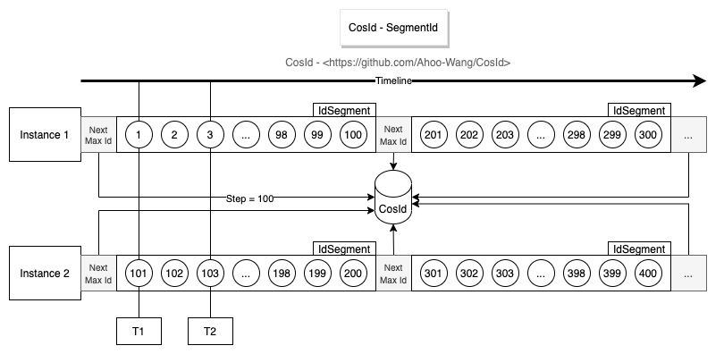
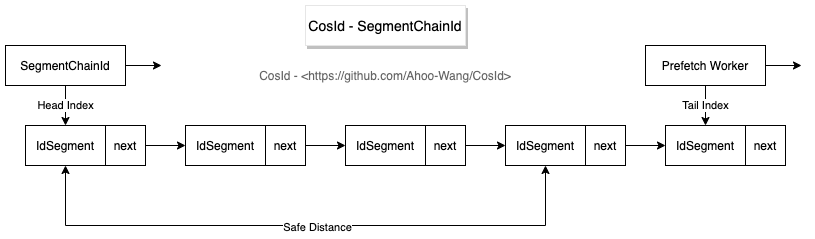

# SegmentId and SegmentChainId

A segment ID comes from a counter in a store. Instead of asking the store for every ID, an instance asks for a block of `step` IDs at once, a *segment*, and hands them out from memory.

<p align="center">
  
</p>

## How it works

The store keeps one counter, the *max id*, for each generator name in a namespace. An `IdSegmentDistributor` adds `step` to it atomically and returns the new value, so the instance owns the IDs from `maxId - step + 1` to `maxId`. No other instance can get them.

- **Ordering.** Each instance hands out increasing IDs, and its next segment is above its last one: IDs are monotonic per instance. Different instances hold different segments at the same time, so across instances IDs are trend increasing, with a disorder window of about `step` times the number of instances. With one instance, IDs are monotonic.
- **Step.** Even `step=1` is not strictly monotonic across instances: two instances can take consecutive IDs and write them in the opposite order. A smaller step keeps IDs closer to sequential and loses fewer of them on restart (the unused rest of a segment is skipped); a larger step means fewer store calls.
- **Offset.** `offset` is the value the counter starts at when it is created, for example to continue after the IDs of an existing table. It applies only to a counter that does not exist yet.
- **Availability.** Generation needs the store whenever a new segment is needed. A segment chain keeps segments in reserve to ride out short store outages.

## DefaultSegmentId

`DefaultSegmentId` (`cosid.segment.mode: segment`) takes the next segment on the calling thread when the current one runs out. That thread waits for a store round trip, which shows in the tail latency: P99.99 of 46.6 µs in the historical CosId 1.x JMH results ([comparison](../../reference/performance/comparison.md), [benchmark](../../reference/performance/benchmark.md)).

## SegmentChainId

<p align="center">
  
</p>

`SegmentChainId` (`cosid.segment.mode: chain`, the default) keeps a chain of segments ahead of the one in use. A background *prefetch worker* keeps the chain at least `safe-distance` segments long (by default 2), so calling threads almost never wait for the store: about 127 million IDs per second with a P99.99 of 0.208 µs in the same historical results, close to an `AtomicLong`.

The chain adapts to demand:

- **Periodic prefetch.** Every `prefetch-worker.prefetch-period` (1 second), the worker tops the chain up to the safe distance.
- **Hunger.** When a calling thread finds no segment left, it takes one itself and wakes the worker, which doubles its prefetch distance (up to `max-prefetch-distance`, 10,000 segments) and asks the store for that many segments in one call. When demand drops, the distance halves back to the safe distance.

So a small `step` works well with a chain: the prefetch distance grows when traffic needs it, and IDs stay close to sequential when it does not.

`SegmentChainId` is `AutoCloseable`: `close()` stops its background prefetch, and generation keeps working without it. `prefetch-timeout` bounds each background prefetch (by default none).

### Why every store reaches the same peak

In the benchmark, a Redis and a MySQL segment chain both reach about 120 million IDs per second at `step=1000`, although Redis answers much faster. Hunger is the reason: the worker keeps doubling the number of segments it takes per call, so with enough time any store hands out IDs faster than threads use them, and the peak is the speed of the in-memory counter.

`TPS(SegmentChainId) ≈ step × expansion × TPS(IdSegmentDistributor) × T ≤ TPS(AtomicLong)`

Here `expansion` is the hunger growth factor of the prefetch distance (2: it doubles), and `T` is how long the benchmark has been running. A faster store only reaches the peak sooner (a smaller `T`).

<p align="center">
  
</p>

## Segment time to live

`ttl` (in seconds, by default forever) makes a segment expire: an instance stops using a segment that is older, skips its remaining IDs and takes a new one. Grouped segments expire at the end of their group on their own.

## Grouped segments

A grouped segment restarts its counter for every group, for example every year, month or day, which gives business numbers such as `BIZ-20260101-00000001`:

```yaml
cosid:
  segment:
    enabled: true
    provider:
      order_no:
        group:
          by: year_month_day
          pattern: yyyyMMdd
        converter:
          type: to_string
          prefix: BIZ-
          group-prefix:
            enabled: true
          to-string:
            pad-start: true
            char-size: 8
```

Each group is its own counter in the store, named `{name}@{group}` (for example `order_no@20260101`), starting at `offset`. `SegmentId.generateGrouped()` returns a `GroupedId` with both the group and the value, and `converter.asString(groupedId)` formats it with the group as prefix. See [ID recipes](../recipes.md) for more examples.

## Segment stores

`cosid.segment.distributor.type` selects the store: `redis` (default), `jdbc`, `mongo`, `zookeeper` or `proxy`, or the type of an application `CosIdStoreProvider`. See [Choosing a backend](../backends/index.md).

## Configuration

```yaml
cosid:
  namespace: ${spring.application.name}
  segment:
    enabled: true
    distributor:
      type: redis
    share:
      step: 100
    provider:
      order:
        offset: 10000
        step: 100
```

This registers the share generator (`__share__SegmentId`) and a generator named `order`, both segment chains. See the [SegmentId configuration](../../reference/config/segment.md) for every property.
