# Machine Slot Lease

A Snowflake id is `(time, slot, sequence)`. Two instances never collide if they never issue **the same timestamp on the
same slot**. 4.x tried to guarantee that by giving each instance a slot (its "machine id"). It then had to trust that
clocks were close, that every instance used the same safe-guard duration, and that a local watermark was written in
time. 5.0 drops those assumptions.

## The idea: lease a time window, not a slot

A lease in 5.0 is the exclusive right to issue **timestamps in a window** `(floor, ceiling]` on one slot:

```
the holder may issue timestamp t only if   floor < t ≤ ceiling
the next holder's floor                  ≥ the largest ceiling the previous holder could have used
```

Successive windows on a slot touch but never overlap. The store keeps that inequality by itself, in one atomic
compare-and-set per change, and the generator checks every id against its window before it issues it. **Uniqueness
follows from that alone (D22): it depends on no clock being right, on no GC pause being short, on no network being
fast.** Clocks only decide *when* a lease expires and someone else may take the slot. That is availability, not
safety.

```mermaid
gantt
    dateFormat  X
    axisFormat  %s
    section slot 3
    holder A (floor 0, ceiling 40)   :a, 0, 40
    holder B (floor 40, ceiling 95)  :b, 40, 95
    holder C (floor 95, ...)         :c, 95, 130
```



| What happens | Effect | Uniqueness |
|---|---|---|
| a host clock runs ahead of the store by more than `tolerance` | the generator reaches its ceiling early and waits for the renewal | kept |
| a host clock runs behind the store | a new holder waits longer to pass its floor | kept |
| the store's clock jumps (failover, NTP) | leases expire earlier or later | kept: floor and ceiling only grow |
| the process pauses past its expiry (GC, VM freeze) | after the pause its timestamps lie past the ceiling: it refuses to issue | kept |

## The lease

```java
public record SlotLease(String namespace, int slot, Owner owner,
                        long fence,      // +1 on every change of ownership; renewals keep it
                        long expiresAt,  // store clock, ms: when someone else may take the slot
                        long floor,      // ms, excluded: this holder's timestamps are > floor
                        long ceiling,    // ms, included: this holder's timestamps are ≤ ceiling
                        long storeNow) {}

public record Owner(String key, UUID incarnation) {}
```

- `ceiling = expiresAt + tolerance`. `tolerance` (default 1s, D20) is how far past the store's expiry a holder may still
  issue. It only trades availability: a larger tolerance rides out more clock skew, and a crashed holder's slot stays
  unusable for longer.
- The **owner key** is the logical identity (`host:port` or `host:pid` by default, or configured). The
  **incarnation** is a UUID per runtime start. A live lease of the same key but another incarnation is **never** taken
  over: the new process gets another slot and reports `onDuplicateOwnerKey`. 4.x took the slot back and could issue
  duplicates for up to a minute.

### Choosing a slot

Each try is one atomic conditional update of a single slot; the order is only a preference:

1. the slot this `(key, incarnation)` already holds: an idempotent retry;
2. `preferred-slot` if it is free (a StatefulSet ordinal, say);
3. a free slot whose last owner had the same key ("sticky", 4.x's *stable*, without the never-expiring lease);
4. the lowest free slot below `2^bits`;
5. none: `Exhausted`, with the earliest expiry to wait for.

### Store-side changes

| Operation | Condition | Change |
|---|---|---|
| acquire | the slot is free or expired | `fence + 1`; `floor = next_floor`; `expiresAt = now + ttl`; `ceiling = max(expiresAt + tolerance, floor)`; `next_floor = ceiling` |
| renew | incarnation and fence match | `expiresAt = max(expiresAt, now + ttl)`; `ceiling` and `next_floor` follow; fence unchanged, so a replayed renewal succeeds |
| release | incarnation and fence match | owner cleared; `next_floor = max(floor, min(lastIssued, ceiling))`; `fence + 1` |

A clean release hands the exact last issued timestamp to the next holder, which can start right after it.

## LeaseKeeper

Each `CosIdRuntime` has one `LeaseKeeper` (D18), and every time-based generator of the runtime shares its slot.

- It renews at `ttl/3`. A failed renewal is retried with back-off (from 100ms, up to `ttl/6`). Until the ceiling the
  generators keep issuing.
- When a renewal finds the lease gone, the old binding is invalidated (generators fail fast with `SlotLostException`)
  and a new slot is acquired, with a new window.
- At start-up an exhausted namespace is retried for `acquireTimeout` (the ttl). Past it, start-up fails.
- `storeNow` is compared with the local clock. A skew above `tolerance/2` raises `onClockSkew` (a metric, not a safety
  check).
- **There is no switch to keep issuing after the lease is lost** (P1): under any model that could duplicate ids.

Shutdown is ordered: each generator moves to a closed state and reports its exact last timestamp, then the slot is
released with it, then the stores and executors close.

## Defaults

| Setting | Default | |
|---|---|---|
| `ttl` | 30s | a crashed instance's slot is free again after at most 30s (+ `tolerance`) |
| renewal | `ttl/3` | |
| `tolerance` | 1s | per namespace (D20): the namespace records `{limit, tolerance}`, and other values are refused |
| `bits` | 10 | 1024 slots; at most the layout's node bits |
| acquire timeout | `ttl` | |

## Static slots

When the deployment already guarantees a unique slot (a fixed number per host, a StatefulSet ordinal), `machine.static`
skips the store. The window then comes from a local file:

```yaml
cosid:
  machine:
    static:
      slot: ${POD_ORDINAL}
      state-file: /var/lib/cosid/state   # keeps the ceiling across restarts
      ahead: 10s
```

- Before the first id the generator writes `ceiling = now + ahead` to the file and fsyncs it. When less than `ahead/2`
  remains, it writes the next ceiling in the background.
- On restart `floor = max(ceiling in the file, not-before)`: a crash followed by a clock jump backwards cannot repeat
  an id.
- **Without `state-file` there is no protection against a clock set back across a restart.** Use it in production.
- `not-before` is the floor while the file does not exist yet. The migration tool writes it (W in the
  [migration guide](../migration/from-4x.md)).
