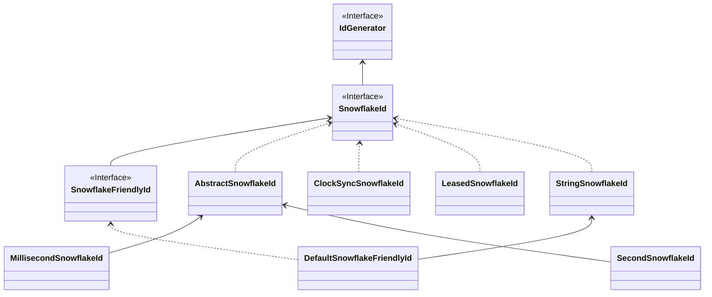

# SnowflakeId

A *SnowflakeId* packs a timestamp, a machine id and a sequence into one 63-bit `long`. Every instance generates IDs on its own, with no call to a store, as long as no two instances use the same machine id at the same time.

<p align="center">
  
</p>

## Layout

The default layout, `MillisecondSnowflakeId`, is `timestamp (41 bits) + machine id (10 bits) + sequence (12 bits) = 63 bits`:

- **Timestamp**: milliseconds since the `epoch`. 41 bits last about 69 years. CosId's default epoch is `1577203200000` (2019-12-24T16:00:00Z); a later epoch leaves more years.
- **Machine id**: 10 bits allow 1024 instances in one namespace at the same time. See [Machine ID](./machine-id.md) for how an instance gets one.
- **Sequence**: 12 bits allow 4096 IDs per millisecond per instance, about 4 million per second. When the sequence runs out, the generator waits for the next millisecond.

`SecondSnowflakeId` (`timestamp-unit: second`) counts seconds instead. `new SecondSnowflakeId(machineId)` uses 31 + 10 + 22 bits, but the starter keeps the configured bits (41 + 10 + 12 by default) and epoch for `timestamp-unit: second`: set `timestamp-bit`, `sequence-bit` and an `epoch` in seconds explicitly, as in the [configuration example](../../reference/config/snowflake.md). Any layout whose bits add up to at most 63 works; `SnowflakeId.layout()` returns it, and machine id bits are limited to 31.

Because the timestamp is in the high bits, IDs of one instance increase monotonically, and IDs across instances are trend increasing, as far apart as the host clocks are.

## Sequence reset

At low traffic, every millisecond would start its sequence at `1`, so most IDs would end in the same few values, and sharding by `id % n` would put almost all rows in one shard. CosId continues the sequence across milliseconds and restarts it only once it has passed `sequence-reset-threshold` (by default half the sequence range, 2047 for 12 bits). This spreads the low bits without costing throughput.

## Clock backwards

A clock that moves backwards could make an instance issue the same timestamp and sequence twice.

- **While running**, the generator keeps its last timestamp and detects a clock behind it. With `clock-sync: true` (the default), `ClockSyncSnowflakeId` waits until the clock catches up: it spins for a jump of at most `cosid.machine.clock-backwards.spin-threshold` (1 ms), sleeps for a jump up to `broken-threshold` (500 ms), and throws `ClockTooManyBackwardsException` beyond that.
- **After a restart**, the last timestamp is gone from memory. The machine id lease keeps a *watermark*, the last timestamp issued under that machine id, and a new owner waits until its clock passes it. See [Machine ID](./machine-id.md#clock-backwards-after-a-restart).

## JavaScript-safe IDs

JavaScript numbers are exact only up to 2<sup>53</sup> - 1, so a 63-bit ID sent as a JSON number loses its low digits in a browser. Either:

- send it as a string: an [ID converter](./id-converter.md) (`radix`, `to_string`, `snowflake_friendly`), or [`cosid-jackson`](../integrations/jackson.md) for selected fields; or
- use a 53-bit layout. `SafeJavaScriptSnowflakeId.ofMillisecond(machineId)` creates one with 41 timestamp, 3 machine id and 9 sequence bits; with the starter, set the bits on a named generator:

```yaml
cosid:
  snowflake:
    provider:
      safe-js:
        namespace: ${spring.application.name}-safe-js
        machine-bit: 3
        sequence-bit: 9
```

Fewer machine id bits mean fewer instances: 3 bits allow 8. Give such a generator its own `namespace`: an instance holds one machine id per namespace, and one leased for 10 bits may not fit in 3.

## Friendly IDs

`SnowflakeFriendlyId` formats an ID as `{timestamp}-{machineId}-{sequence}`, for example `20210623131730192-1-0`, and parses it back. With the starter, use `converter.type: snowflake_friendly`; the timestamp is formatted in `cosid.snowflake.zone-id`.

## Implementations



| Class | Role |
|-------|------|
| `MillisecondSnowflakeId` | Millisecond timestamps, the default |
| `SecondSnowflakeId` | Second timestamps |
| `ClockSyncSnowflakeId` | Waits out a clock that moved backwards (`clock-sync: true`) |
| `LeasedSnowflakeId` | Throws `MachineIdLostException` once the machine id lease is lost or expired (`cosid.machine.guarder.fail-fast: true`) |
| `StringSnowflakeId` | Uses a configured converter for `generateAsString()` |
| `DefaultSnowflakeFriendlyId` | Friendly string format |

## Configuration

Snowflake IDs need a machine id, so enable the machine id as well:

```yaml
cosid:
  namespace: ${spring.application.name}
  machine:
    enabled: true
    distributor:
      type: redis
  snowflake:
    enabled: true
    provider:
      order:
        converter:
          type: radix
```

This registers the share generator (`__share__SnowflakeId`) and a generator named `order`. See the [SnowflakeId configuration](../../reference/config/snowflake.md) and the [machine ID configuration](../../reference/config/machine.md) for every property.
