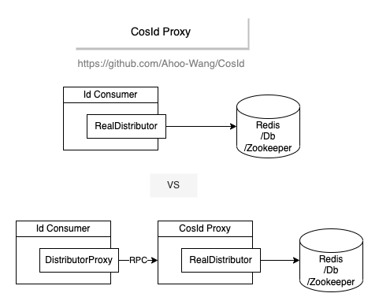

# CosId Proxy

CosId Proxy 是位于应用与存储之间的一个小型 HTTP 服务。应用向 Proxy 租用机器号、获取号段，只有 Proxy 持有存储的地址和凭据。ID 仍然在每个应用内部生成；只有原本需要访问存储的地方才会调用 Proxy。

<p align="center">
  
</p>

```
┌──────────────────────────┐      HTTP       ┌───────────────────┐       ┌────────────────────┐
│ Application              │ ──────────────► │ cosid-proxy-server│ ────► │ Redis / JDBC / ... │
│ ProxyMachineLeaseStore   │                 │                   │       │                    │
│ ProxyIdSegmentDistributor│                 │                   │       │                    │
└──────────────────────────┘                 └───────────────────┘       └────────────────────┘
```

Use it when applications must not reach the store directly, for example across network zones, or to keep one set of store credentials. It adds a service to run and secure, and a network hop at startup, at lease renewal and at segment prefetch.

适用于应用不能直接访问存储的场景，例如跨网络分区，或者希望只维护一套存储凭据。代价是多运行并保护一个服务，并且在启动、租约续约和号段预取时多一次网络往返。

## 运行服务端

服务端是 `cosid-proxy-server`，一个 Spring Boot 应用，以 Docker 镜像 `ahoowang/cosid-proxy` 发布。它监听 `8688` 端口，默认使用 Redis；配置它的存储与配置应用完全相同，使用 `cosid.machine.distributor.type` 和 `cosid.segment.distributor.type`。

```shell
docker run --name cosid-proxy -d -p 8688:8688 --link redis \
  -e SPRING_DATA_REDIS_URL=redis://redis:6379 \
  -e COSID_PROXY_TOKEN=change-me \
  ahoowang/cosid-proxy:__COSID_VERSION__
```

请使用 `--network`（或 `--link redis`）让容器能访问 Redis，并使用已发布的镜像标签，例如当前版本 `__COSID_VERSION__` 或 `latest`。

没有令牌时服务端会拒绝启动，见[认证](#认证)。

容器和编排系统的健康检查请使用 `/actuator/health/liveness`（镜像的 `HEALTHCHECK` 就是如此）：它不访问存储即可应答。`/actuator/health` 包含存储，存储故障时为 `DOWN`，存储卡住时会一直等到存储的健康检查返回：适合用于告警。默认的 `/actuator/health/readiness` 分组同样不包含存储。

镜像包含所有存储的驱动：Redis、MySQL、PostgreSQL、MongoDB 和 ZooKeeper。默认配置 Redis；`DataSourceAutoConfiguration` 和 `MongoAutoConfiguration` 在 `spring.autoconfigure.exclude` 中，避免未使用的存储出现在健康检查中。使用其他存储时，请设置排除列表，只保留所选的存储：否则健康检查会把未使用的 Redis 报告为 `DOWN`，整体状态为 `DOWN`，容器会被标记为不健康。以 PostgreSQL 为例：

```shell
docker run --name cosid-proxy -d -p 8688:8688 \
  -e COSID_PROXY_TOKEN=change-me \
  -e SPRING_AUTOCONFIGURE_EXCLUDE=org.springframework.boot.data.redis.autoconfigure.DataRedisAutoConfiguration,org.springframework.boot.data.redis.autoconfigure.DataRedisReactiveAutoConfiguration,org.springframework.boot.mongodb.autoconfigure.MongoAutoConfiguration \
  -e SPRING_DATASOURCE_URL=jdbc:postgresql://postgres:5432/cosid_db \
  -e SPRING_DATASOURCE_USERNAME=cosid -e SPRING_DATASOURCE_PASSWORD=change-me \
  -e COSID_MACHINE_DISTRIBUTOR_TYPE=jdbc -e COSID_SEGMENT_DISTRIBUTOR_TYPE=jdbc \
  -e SPRING_APPLICATION_JSON='{"cosid": {...}}' \
  ahoowang/cosid-proxy:__COSID_VERSION__
```

JDBC 的默认语句是 MySQL 语句：使用 PostgreSQL 时，请先建表（或者设置 `enable-auto-init-*` 并配置 PostgreSQL 的建表语句），并按照 [JDBC：PostgreSQL](./jdbc.md#postgresql) 覆盖号段语句，例如通过 `SPRING_APPLICATION_JSON` 或挂载的 `config/application.yaml`。`SPRING_AUTOCONFIGURE_EXCLUDE` 会替换整个默认列表，因此必须列出所有未使用的存储：

| 存储 | `SPRING_AUTOCONFIGURE_EXCLUDE` |
|------|--------------------------------|
| Redis（默认） | `org.springframework.boot.jdbc.autoconfigure.DataSourceAutoConfiguration,org.springframework.boot.mongodb.autoconfigure.MongoAutoConfiguration` |
| JDBC（MySQL、PostgreSQL） | `org.springframework.boot.data.redis.autoconfigure.DataRedisAutoConfiguration,org.springframework.boot.data.redis.autoconfigure.DataRedisReactiveAutoConfiguration,org.springframework.boot.mongodb.autoconfigure.MongoAutoConfiguration` |
| MongoDB（还需配置 `spring.mongodb.uri`） | `org.springframework.boot.data.redis.autoconfigure.DataRedisAutoConfiguration,org.springframework.boot.data.redis.autoconfigure.DataRedisReactiveAutoConfiguration,org.springframework.boot.jdbc.autoconfigure.DataSourceAutoConfiguration` |
| ZooKeeper | `org.springframework.boot.data.redis.autoconfigure.DataRedisAutoConfiguration,org.springframework.boot.data.redis.autoconfigure.DataRedisReactiveAutoConfiguration,org.springframework.boot.jdbc.autoconfigure.DataSourceAutoConfiguration,org.springframework.boot.mongodb.autoconfigure.MongoAutoConfiguration` |

在镜像中，堆大小为容器内存上限的 75%（`-XX:MaxRAMPercentage=75.0`）；如需固定，请设置 `JAVA_OPTS`，例如 `-e JAVA_OPTS=-Xmx1g`。镜像之外的发行包启动脚本仍使用固定的 1280M 堆。`GET /ids` 的响应带有 `Cache-Control: no-store`，避免客户端与服务端之间的缓存把同一个 ID 发出两次。

## 客户端

### 安装

::: code-group
```kotlin [Gradle (Kotlin)]
dependencies {
    implementation(platform("me.ahoo.cosid:cosid-bom:$cosidVersion"))
    implementation(platform("me.ahoo.cosid:cosid-dependencies:$cosidVersion")) // 管理 CoApi 的版本
    implementation("me.ahoo.cosid:cosid-spring-boot-starter")
    implementation("me.ahoo.cosid:cosid-proxy")
    implementation("me.ahoo.coapi:coapi-spring-boot-starter")
}
```
```xml [Maven]
<dependencies>
    <dependency>
        <groupId>me.ahoo.cosid</groupId>
        <artifactId>cosid-spring-boot-starter</artifactId>
    </dependency>
    <dependency>
        <groupId>me.ahoo.cosid</groupId>
        <artifactId>cosid-proxy</artifactId>
    </dependency>
    <dependency>
        <groupId>me.ahoo.coapi</groupId>
        <artifactId>coapi-spring-boot-starter</artifactId>
    </dependency>
</dependencies>
```
:::

使用 Maven 时，还需要把 `me.ahoo.cosid:cosid-dependencies` 作为 BOM 导入，以管理 CoApi 的版本。

### 配置

```yaml
cosid:
  namespace: ${spring.application.name}
  proxy:
    host: http://cosid-proxy:8688
    token: ${COSID_PROXY_TOKEN}
  machine:
    enabled: true
    distributor:
      type: proxy
  segment:
    enabled: true
    distributor:
      type: proxy
```

| 属性 | 默认值 | 说明 |
|------|--------|------|
| `cosid.proxy.host` | `http://localhost:8688` | Proxy 服务端的基础 URL |
| `cosid.proxy.token` | 无 | 每个请求携带的 Bearer 令牌 |
| `cosid.proxy.connect-timeout` | `2s` | 连接服务端的超时；`0` 表示不限制 |
| `cosid.proxy.read-timeout` | `5s` | 等待响应的超时，包括启动时申领机器号；`0` 表示不限制，但 `cosid.machine.distributor.type=proxy` 时必须为正数 |
| `cosid.proxy.client` | `coapi` | `coapi` 或 `http-interface`，见下文；类路径上没有 CoApi 时使用 `http-interface` |

客户端与其他后端一样，是一个 `MachineLeaseStore` 和一个 `IdSegmentDistributor`：`ProxyMachineLeaseStore` 调用服务端的租约 API（`/machines/v2`）申领、续约和释放机器号，`ProxyIdSegmentDistributor` 向服务端申请号段。默认由 CoApi 创建客户端，它支持 `lb://` 地址，并应用 `coapi.*` 配置和你的 CoApi 定制器。设置 `cosid.proxy.client=http-interface`，或者类路径上没有 CoApi 时，客户端会作为普通 Bean，使用 Spring 的 `HttpServiceProxyFactory` 基于你的 `RestClient.Builder` 创建，并应用上面的地址、超时和令牌；Spring AOT 预处理支持这种方式。

## 认证

服务端至少需要一个 Bearer 令牌，没有令牌时启动失败。在服务端配置令牌，并在每个客户端配置相同的令牌：

```yaml
# Proxy 服务端
cosid:
  proxy:
    server:
      auth:
        tokens:
          - ${COSID_PROXY_TOKEN}   # 可配置多个令牌用于轮换
        public-paths:              # 无需令牌；默认为健康检查端点
          - /actuator/health
          - /actuator/health/**
```

除公开路径外，所有没有携带有效 `Authorization: Bearer <token>` 的请求都返回 `401`，包括 actuator 端点（其中一些会生成或删除 ID）和 API 文档。公开路径是按解码后路径匹配的路径模式，默认为 `management.endpoints.web.base-path` 下的健康检查端点。如需开放 API 文档，添加 `/v3/api-docs/**`、`/swagger-ui.html` 和 `/webjars/swagger-ui/**`（服务端使用基于 WebFlux 的 springdoc）。

`cosid.proxy.server.auth.allow-anonymous: true` 让服务端在没有令牌的情况下运行；仅在可信的网络边界之内使用。

## 服务端限制

服务端会校验客户端的请求，超出以下限制的请求返回 `400`：

| 属性 | 默认值 | 说明 |
|------|--------|------|
| `cosid.proxy.server.min-safe-guard-duration` | `5m` | 只有租约最后一次续约（按存储时钟）距今至少这么久，客户端才能接管该机器号。4.0 客户端发送更晚的截止时间会得到 `400`；3.x 客户端更短的守护时长会被提升到该值并记录警告。请不要大于客户端的 `cosid.machine.guarder.safe-guard-duration`；不能为负数 |
| `cosid.proxy.server.max-clock-skew` | `1m` | 客户端上报的最后时间戳最多可以比存储的时钟（v1 API 为服务端时钟）快多少；过于超前的时间戳会让机器号永远无法回收。`0` 表示不检查；不能为负数 |
| `cosid.proxy.server.segment.max-step` | `1000000000000` | 客户端可申请的最大号段步长；`0` 表示不限制。号段链一次会申请 `step × 号段数`，负载高时更多，因此请至少设置为所有客户端中最大的 `step × max-prefetch-distance`。`offset` 必须在 `0` 到 `Long.MAX_VALUE / 2` 之间 |
| `cosid.proxy.server.segment.max-distributors` | `0` | 服务端在内存中保留的号段分发器上限，每个命名空间和名称一个，所有命名空间共享；超出后请求新的分发器返回 `429`（而非 `400`）。`0` 表示不限制；不可信的客户端能访问服务端时请设置，例如 `10000` |

## 部署安全

- 只在内网运行服务端，绝不暴露到公网。任何能调用它的人都可以释放存活实例持有的机器号，导致两个实例生成相同的 ID。
- 令牌是 Bearer 凭据：持有者可以对它能使用的所有命名空间调用所有端点。请用 `cosid.proxy.server.auth.clients` 为每个应用分配只能使用自己命名空间的令牌，并在 `cosid.proxy.server.namespaces` 中列出提供服务的命名空间。请通过 HTTPS 或启用双向 TLS 的服务网格传输令牌（客户端配置了令牌且 host 是 localhost 以外的 `http` 地址时会打印警告），保存在密钥管理系统中，轮换时同时配置新旧两个令牌。
- `cosid.proxy.server.segment.max-step` 保持为有限值，避免单个请求耗尽或溢出计数器。
- 服务端不开启 JMX。如需通过 JMX 监控，请在 `JAVA_OPTS` 中传入参数，并启用认证和 TLS：

```shell
JAVA_OPTS="-Dcom.sun.management.jmxremote.port=5555 \
  -Dcom.sun.management.jmxremote.authenticate=true \
  -Dcom.sun.management.jmxremote.password.file=/opt/cosid-proxy-server/config/jmxremote.password \
  -Dcom.sun.management.jmxremote.access.file=/opt/cosid-proxy-server/config/jmxremote.access \
  -Dcom.sun.management.jmxremote.ssl=true \
  -Djavax.net.ssl.keyStore=/opt/cosid-proxy-server/config/jmx.p12 \
  -Djavax.net.ssl.keyStorePassword=${JMX_KEYSTORE_PASSWORD}"
```

未认证的 JMX 等于把 JVM 的完全控制权交出去；堆转储还会泄露令牌和存储密码。

## 监控

服务端在 `/actuator/prometheus` 暴露 Prometheus 指标，例如 JVM、按 API 路径和状态码统计的 HTTP 请求，以及服务端自身生成器和机器号租约的 [CosId 指标](../operations/monitoring.md#指标)。与健康检查以外的所有端点一样，它需要令牌：

```yaml
scrape_configs:
  - job_name: cosid-proxy
    metrics_path: /actuator/prometheus
    authorization:
      credentials: change-me   # 服务端的令牌
    static_configs:
      - targets: ['cosid-proxy:8688']
```

## 可用性

服务端不保存客户端状态：租约和计数器都在它的存储中。可以在负载均衡器后面运行多个服务端以提高可用性。服务端重启后，运行中的客户端无需重启即可继续：服务端会在下一个请求时从存储重建号段分配器。

## 从 3.x 升级

1. 在 3.4.x 客户端上设置 `cosid.proxy.token`（3.4 会发送它，没有令牌的服务端会忽略它）。
2. 升级服务端，并在 `cosid.proxy.server.auth.tokens` 中配置同一个令牌。如果在客户端配置令牌之前升级服务端，这些客户端会得到 `401`。
3. 升级客户端。服务端的 `min-safe-guard-duration` 不要大于客户端的 `cosid.machine.guarder.safe-guard-duration`。

4.0 服务端为 3.x 客户端保留了已弃用的 v1 机器号 API（`/machines/{namespace}`），4.0 客户端使用 3.x 服务端没有的 v2 租约 API。见[迁移到 4.0](../migration/4.0.md)。
