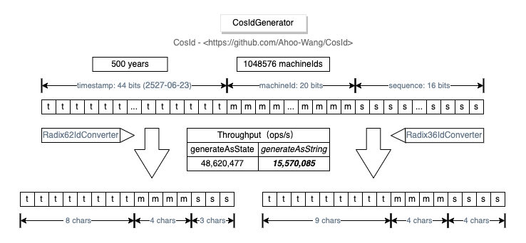

# CosIdGenerator

`CosIdGenerator` 为超大规模集群生成按时间有序的字符串 ID。它的 80 位布局为机器号留出 20 位，一个命名空间约可容纳一百万个实例，而 63 位的 Snowflake ID 只能容纳 1024 个。

<p align="center">
  
</p>

## 位布局

`时间戳（44 位）+ 机器号（20 位）+ 序列号（16 位）= 80 位`

- **时间戳**：自 Unix 纪元起的毫秒数。
- **机器号**：与 Snowflake 机器号一样通过租约获得，见[机器号](./machine-id.md)。
- **序列号**：每个实例每毫秒 65,536 个 ID，与 [Snowflake 序列号](./snowflake.md#序列号重置)一样在超过一半范围后重新开始。

ID 由这三部分分别编码成定长字符串拼接而成，因此按字符串排序就是生成顺序，三部分也都可以解析回来（`getStateParser().asState(id)`）。

| 类型 | 编码 | 长度 | 各部分字符数 |
|------|------|------|--------------|
| `RADIX62`（默认） | `0-9A-Za-z` | 15 个字符 | 时间戳 8 + 机器号 4 + 序列号 3 |
| `RADIX36` | `0-9A-Z` | 17 个字符 | 时间戳 9 + 机器号 4 + 序列号 4 |
| `FRIENDLY` | `yyyyMMddHHmmssSSS-机器号-序列号` | 不定长 | 可读格式，按 `cosid.generator.zone-id` 显示 |

62 进制的 ID 区分大小写：请存放在区分大小写（二进制排序）的列中。

## 特性

- 按时间有序：单实例递增，跨实例趋势递增。
- 快：单实例每秒约 1557 万个 ID，是 `UUID.randomUUID()` 的三倍。
- 短：15 个字符，UUID 字符串为 36 个。

`CosIdGenerator` 是 `StringIdGenerator`：没有 `long` 形式，因此不能填充 `long` 字段，也不能作为共享生成器。

## 配置

```yaml
cosid:
  namespace: ${spring.application.name}
  machine:
    enabled: true
    distributor:
      type: redis
  generator:
    enabled: true
```

Starter 会注册一个 `CosIdGenerator` Bean，并以 `cosid` 为名注册到 `IdGeneratorProvider`。在 `String` 字段上标注 `@CosId("cosid")` 即可用它填充。见 [CosIdGenerator 配置](../../reference/config/cosid-generator.md)。
