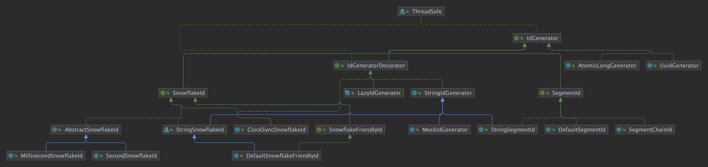

# ID 生成器

CosId 的所有生成器都实现 `cosid-core` 中的两个接口之一：

```java
public interface StringIdGenerator extends Statistical {
    String generateAsString();
}

public interface IdGenerator extends StringIdGenerator {
    long generate();

    default IdConverter idConverter() {
        return ToStringIdConverter.INSTANCE;
    }

    @Override
    default String generateAsString() {
        return idConverter().asString(generate());
    }
}
```

`IdGenerator` 生成 `long` 型 ID，并通过其 [ID 转换器](./id-converter.md) 格式化为字符串。`StringIdGenerator` 只生成字符串：`CosIdGenerator` 和 `UuidGenerator` 都是只生成字符串的生成器，没有 `generate()`。

<p align="center">
  
</p>

## 生成器

| 生成器 | 接口 | 协调方式 | 说明 |
|--------|------|----------|------|
| [`SegmentChainId`](./segment.md) | `IdGenerator`（`SegmentId`） | 从 `IdSegmentDistributor` 获取号段并提前预取 | 号段的默认模式（`cosid.segment.mode=chain`） |
| [`DefaultSegmentId`](./segment.md) | `IdGenerator`（`SegmentId`） | 当前号段用完时，由调用线程获取下一个号段 | `cosid.segment.mode=segment` |
| [`MillisecondSnowflakeId`](./snowflake.md) | `IdGenerator`（`SnowflakeId`） | 需要一个[机器号](./machine-id.md) | 默认的 Snowflake 布局：41 位时间戳、10 位机器号、12 位序列号 |
| [`SecondSnowflakeId`](./snowflake.md) | `IdGenerator`（`SnowflakeId`） | 需要一个机器号 | 以秒为单位的时间戳，`timestamp-unit: second` |
| [`CosIdGenerator`](./cosid-generator.md) | `StringIdGenerator` | 需要一个机器号 | 62 进制、36 进制或友好格式字符串；机器号最多 20 位 |
| `UuidGenerator` | `StringIdGenerator` | 无 | `UuidGenerator.INSTANCE`，随机 UUID 字符串，即 `UUID.randomUUID().toString()` |

装饰器在不改变生成器类型的前提下增加行为：`ClockSyncSnowflakeId` 等待回拨的时钟追上来，`LeasedSnowflakeId` 在机器号租约丢失后停止生成，`StringSnowflakeId` 和 `StringSegmentId` 让 `generateAsString()` 使用配置的转换器。Spring Boot Starter 会根据配置自动套上这些装饰器。

## 如何选择生成器

1. **需要 `long` 吗？** 大多数数据库和 ORM 需要数字主键，此时使用号段链或 Snowflake ID。如果字符串就可以，所有生成器都能生成字符串。
2. **希望 ID 彼此接近吗？** 号段链发放的是接近连续的数字（每个实例 `1, 2, 3, ...`，以 `step` 为单位分块），键更短、索引更紧凑。Snowflake ID 是很大的数（约 2<sup>60</sup>）。
3. **ID 必须携带时间吗？** Snowflake ID 可以解析出时间戳、机器号和序列号，因此仅凭 ID 就能按时间分片（见[时间范围分片](../integrations/sharding/interval-timeline.md)）。
4. **已经在运行哪些存储？** 号段链在预取时需要能访问号段存储；Snowflake 和 CosIdGenerator 只在启动时租用机器号、以及续约时需要存储。
5. **有多少个实例？** 默认 Snowflake 布局有 10 位机器号，每个命名空间 1024 个实例；`CosIdGenerator` 有 20 位，约一百万个。
6. **ID 会发给浏览器吗？** JavaScript 数字只能精确表示到 2<sup>53</sup>。把 Snowflake ID 以字符串形式发送，或使用 [JavaScript 安全布局](./snowflake.md#javascript-安全的-id)。

拿不准时，主键和业务编号先从号段链开始。

## 使用生成器

使用 Spring Boot Starter 时，每个配置的生成器都以其名称注册到 `IdGeneratorProvider`，共享生成器的名称为 `__share__`：

```java
@Service
public class OrderService {
    private final IdGeneratorProvider provider;

    public OrderService(IdGeneratorProvider provider) {
        this.provider = provider;
    }

    public long newOrderId() {
        return provider.getRequired("order", IdGenerator.class).generate();
    }

    public long newShareId() {
        return provider.getShare().generate();
    }
}
```

每个生成器同时也是名为 `{name}SegmentId` 或 `{name}SnowflakeId` 的 Bean（例如 `orderSegmentId`、`__share__SnowflakeId`），CosId 生成器则是 `CosIdGenerator` Bean，在容器中注册为 `cosid`。查找方式见 [ID 生成器容器](./provider.md)；如果想在不手动调用生成器的情况下填充实体字段，见 [`@CosId`](../integrations/annotation.md)。
