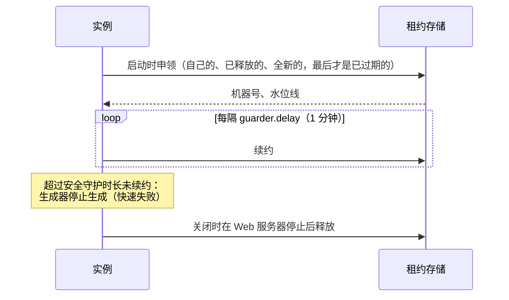

# 机器号

*机器号*是 [Snowflake ID](./snowflake.md)（以及 [CosIdGenerator](./cosid-generator.md) ID）中的 worker-id 字段。两个实例如果同时用同一个机器号生成 ID，就可能生成相同的 ID，因此每个运行中的实例都必须持有不同的机器号。

虽然叫“机器号”，它与物理机器无关。机器号由*实例*持有，一个实例就是一个运行中的进程，用 `InstanceId` 标识：设置了 `cosid.machine.instance-id` 时使用该值；否则稳定实例使用主机地址加进程号（`192.168.1.10:12345`），非稳定实例使用主机地址、进程号加启动时生成的随机后缀（`192.168.1.10:12345:3f9a1c2e`）。同一台主机上的多个进程各自持有自己的机器号。

::: warning 容器
共享主机地址的多个容器可能都以 1 号进程运行。自 4.0.2 起，非稳定实例的默认 ID 带随机后缀，这样的两个容器不会共用一个机器号。代价是：非稳定实例被强制终止后重启，每次都会领取新的机器号，旧机器号要等安全守护时长过后才会释放，因此反复崩溃重启可能耗尽机器号。要在重启后保留同一个机器号，请配置带显式 ID 的稳定实例，例如 `cosid.machine.stable: true` 加 `cosid.machine.instance-id: ${HOSTNAME}`。在容器中使用默认 ID 时，启动会打印告警。
:::为了与已有的配置和 API 保持兼容，CosId 沿用“机器号”这个名称。

机器号按*命名空间*（`cosid.namespace`，通常是应用名）隔离：不同应用的实例可以持有相同的机器号，因为它们的 ID 不会相遇。

## 获取机器号

`cosid.machine.distributor.type` 决定实例如何获得机器号：

| 类型 | 方式 | 回收 | 适用场景 |
|------|------|------|----------|
| `redis`、`jdbc`、`mongo`、`zookeeper`、`proxy` | 从存储租用（在对应后端的 `MachineLeaseStore` 上使用 `LeaseStoreMachineIdDistributor`） | 租约过期后回收 | 几乎所有场景：选择你已经在运行的存储，见[选择后端](../backends/index.md) |
| `stateful_set` | Kubernetes StatefulSet Pod 的序号，从 `HOSTNAME` 解析（`order-service-3` 得到 3） | 不需要 | StatefulSet 中的 Pod；序号必须在机器号位数范围内 |
| `manual`（默认） | `cosid.machine.distributor.manual.machine-id` | 不回收 | 单实例或测试。无法阻止两个实例使用同一个值 |
| 其他值 | `getType()` 与之匹配的 `CosIdStoreProvider` Bean | 取决于实现 | CosId 未内置的存储 |

## 租约

使用租约存储时，机器号是一份需要不断续约的租约。



1. **申领。** 启动时，实例依次尝试：自己已经持有的租约（使用相同实例 ID 重启时）、其他实例已释放的机器号、从未使用过的机器号，最后才是超过 `cosid.machine.guarder.safe-guard-duration`（5 分钟）未续约的机器号。如果都没有，启动失败并抛出 `MachineIdOverflowException`。申领是原子的：多个实例竞争时，每个机器号只会分给其中一个。
2. **续约。** 守护器在 `initial-delay`（1 分钟）之后，每隔 `cosid.machine.guarder.delay`（1 分钟）续约一次。续约失败会记录日志，`machineId` 健康指示器报告 `DOWN`，直到下一次续约成功。
3. **快速失败。** 开启 `cosid.machine.guarder.fail-fast: true`（默认）时，一旦租约丢失（机器号已被其他实例持有），或者超过安全守护时长未续约（再减去一个时钟偏差余量 `min(10s, safe-guard-duration / 10)`），生成器会抛出 `MachineIdLostException` 而不是继续生成。请求失败好过生成重复的 ID。
4. **释放。** 关闭时，在 Web 服务器停止接收请求之后，实例停止生成器并释放机器号，下一个实例可以立即使用它。稳定实例会保留自己的机器号：释放只会提升水位线。

进程被强制终止时租约不会再续约，超过安全守护时长后，其他实例就可以接管它。

::: warning 同一命名空间内保持规则一致
同一命名空间的所有实例必须使用相同的 `safe-guard-duration`。安全守护时长较短的实例可能接管一份持有者仍认为有效的租约，两者随后会生成相同的 ID。同时请保持各主机时钟同步（NTP）：存储自带时钟时（Redis、数据库、MongoDB，以及 Proxy 所用的存储），租约时间取自存储的时钟，否则（ZooKeeper）取自主机时钟。
:::

### 稳定实例

`cosid.machine.stable: true` 用于标记身份在重启后保持不变的实例，例如固定主机上固定的 `instance-id`。其他实例永远不会接管它的机器号，即使它离线超过安全守护时长；它自己也不会接管其他实例已过期的租约。稳定实例还会把机器状态保存在本地文件中（`cosid.machine.state-storage.local.state-location`，默认为 `~/.cosid-machine-state`）。只把一定会回来的实例标记为稳定：稳定实例的机器号如果不释放，会一直被占用。

## 重启后的时钟回拨

生成器在运行期间能发现时钟回拨（[见 SnowflakeId](./snowflake.md#时钟回拨)）。重启之后，上一次的时间戳已不在内存中，因此 CosId 把它和机器号一起保存：

- 每份租约都带有一个*水位线*，即该机器号最后使用的时间戳，在每次申领和释放时提升。新的持有者如果时钟落后于水位线，会按 `cosid.machine.clock-backwards` 的阈值等待自己的时钟越过它：落后超过 `broken-threshold`（500 毫秒）时，启动失败并抛出 `ClockTooManyBackwardsException`，机器号会被再次释放。
- 稳定实例还会每隔 `cosid.machine.guarder.local-state-interval`（1 秒）把最后的时间戳写入本地状态文件。进程崩溃后，短于这个间隔的时钟回拨可能无法发现。

这就是各主机时钟必须同步的原因：时钟偏快的主机会留下一个水位线，接手它机器号的实例必须等待。

## 机器号位数

`cosid.machine.machine-bit`（10）决定一个命名空间有多少个机器号，必须与生成器的布局一致。每个生成器可以用自己的 `machine-bit` 覆盖它；此时请同时给该生成器设置单独的 `namespace`，因为一个实例在每个命名空间只持有一个机器号。

## 配置

```yaml
cosid:
  namespace: ${spring.application.name}
  machine:
    enabled: true
    distributor:
      type: redis
    guarder:
      safe-guard-duration: 5m
```

全部属性见[机器号配置](../../reference/config/machine.md)。
