# 机器号槽位租约

Snowflake ID 是 `(time, slot, sequence)`。只要两个实例从不在**同一槽位上发出相同的时间戳**，它们就不会冲突。
4.x 试图通过给每个实例分配一个槽位（它的"机器号"）来保证这一点。于是它不得不相信：各时钟相差不大、每个实例使用相同的
safe-guard 时长、本地水位线及时写盘。5.0 去掉了这些假设。

## 思路：租用时间窗口，而不是槽位

5.0 中的租约是在一个槽位上发出**某个窗口 `(floor, ceiling]` 内时间戳**的独占权：

```
the holder may issue timestamp t only if   floor < t ≤ ceiling
the next holder's floor                  ≥ the largest ceiling the previous holder could have used
```

同一槽位上相继的窗口首尾相接、互不重叠。存储自己维护这条不等式，每次变更一次原子 compare-and-set；
生成器在发出每个 ID 之前都会检查它是否落在窗口内。**唯一性仅由此得出（D22）：不依赖任何时钟准确、不依赖 GC 停顿短暂、
不依赖网络快速。** 时钟只决定租约*何时*过期、他人何时可以取得该槽位。这是可用性，而不是安全性。

```mermaid
gantt
    dateFormat  X
    axisFormat  %s
    section slot 3
    holder A (floor 0, ceiling 40)   :a, 0, 40
    holder B (floor 40, ceiling 95)  :b, 40, 95
    holder C (floor 95, ...)         :c, 95, 130
```



| 发生的情况 | 影响 | 唯一性 |
|---|---|---|
| 主机时钟比存储快出超过 `tolerance` | 生成器提前到达 ceiling，等待续约 | 保持 |
| 主机时钟比存储慢 | 新持有者需要等待更久才能越过 floor | 保持 |
| 存储时钟跳变（故障切换、NTP） | 租约提前或推迟过期 | 保持：floor 与 ceiling 只增不减 |
| 进程暂停超过过期时间（GC、虚拟机冻结） | 暂停结束后其时间戳超出 ceiling：拒绝发号 | 保持 |

## 租约

```java
public record SlotLease(String namespace, int slot, Owner owner,
                        long fence,      // 每次所有权变化 +1；续约不变
                        long expiresAt,  // 存储时钟，毫秒：他人何时可以取得该槽位
                        long floor,      // 毫秒，不含：本任持有者的时间戳 > floor
                        long ceiling,    // 毫秒，含：本任持有者的时间戳 ≤ ceiling
                        long storeNow) {}

public record Owner(String key, UUID incarnation) {}
```

- `ceiling = expiresAt + tolerance`。`tolerance`（默认 1s，D20）是持有者在存储过期时间之后仍可发号的量。
  它只用于权衡可用性：tolerance 越大，能扛住的时钟偏差越大，崩溃持有者的槽位不可用的时间也越长。
- **所有者 key** 是逻辑身份（默认为 `host:port` 或 `host:pid`，也可配置）。**incarnation** 是每次运行时启动生成的 UUID。
  同一 key 但不同 incarnation 的存活租约**绝不**被接管：新进程拿到另一个槽位，并报告 `onDuplicateOwnerKey`。
  4.x 会把槽位收回，可能在长达一分钟内发出重复 ID。

### 选槽

每次尝试都是对单个槽位的一次原子条件更新；顺序只是一种偏好：

1. 该 `(key, incarnation)` 已持有的槽位：幂等重试；
2. `preferred-slot`（若空闲），例如 StatefulSet 序号；
3. 上一任所有者 key 相同的空闲槽位（"粘性"，即 4.x 的 *stable*，但没有永不过期的租约）；
4. `2^bits` 以下编号最小的空闲槽位；
5. 都没有：`Exhausted`，附带需要等待的最早过期时间。

### 存储端变更

| 操作 | 条件 | 变更 |
|---|---|---|
| acquire | 槽位空闲或已过期 | `fence + 1`；`floor = next_floor`；`expiresAt = now + ttl`；`ceiling = max(expiresAt + tolerance, floor)`；`next_floor = ceiling` |
| renew | incarnation 与 fence 均匹配 | `expiresAt = max(expiresAt, now + ttl)`；`ceiling` 与 `next_floor` 随之更新；fence 不变，因此重放的续约也会成功 |
| release | incarnation 与 fence 均匹配 | 清除 owner；`next_floor = max(floor, min(lastIssued, ceiling))`；`fence + 1` |

正常释放会把精确的最后发出时间戳交给下一任持有者，下一任可以紧接其后开始。

## LeaseKeeper

每个 `CosIdRuntime` 有一个 `LeaseKeeper`（D18），运行时内的所有时间型生成器共用它的槽位。

- 每 `ttl/3` 续约一次。续约失败时退避重试（从 100ms 开始，最多 `ttl/6`）。在到达 ceiling 之前生成器持续发号。
- 续约发现租约已丢失时，旧的绑定失效（生成器以 `SlotLostException` 快速失败），并获取一个新槽位与新窗口。
- 启动时，命名空间槽位耗尽会在 `acquireTimeout`（即 ttl）内重试。超过后启动失败。
- `storeNow` 会与本地时钟比较。偏差超过 `tolerance/2` 时触发 `onClockSkew`（只是一个指标，不是安全检查）。
- **不提供租约丢失后继续发号的开关**（P1）：在任何模型下这都可能产生重复 ID。

关闭是有序的：每个生成器先进入关闭状态并报告其精确的最后时间戳，然后用它释放槽位，最后关闭存储与执行器。

## 默认值

| 设置 | 默认值 | |
|---|---|---|
| `ttl` | 30s | 崩溃实例的槽位最多 30s（+ `tolerance`）后再次空闲 |
| 续约 | `ttl/3` | |
| `tolerance` | 1s | 按命名空间（D20）：命名空间记录 `{limit, tolerance, slotOffset}`，其他取值会被拒绝 |
| `bits` | 10 | 1024 个槽位；不超过布局的 node 位数 |
| `acquire-timeout` | `ttl` | 启动时等待空闲槽位的时长；0 表示只尝试一次（D42） |
| `slot-offset` | 0 | [槽位偏移](#槽位偏移) |

## 静态槽位

当部署本身已保证槽位唯一（每台主机一个固定编号、StatefulSet 序号）时，`machine.static` 跳过存储。此时窗口来自一个本地文件：

```yaml
cosid:
  machine:
    static:
      slot: ${POD_ORDINAL}
      state-file: /var/lib/cosid/state   # 在重启之间保留 ceiling
      ahead: 10s
```

- 发出第一个 ID 之前，生成器把 `ceiling = now + ahead` 写入文件并 fsync。剩余不足 `ahead/2` 时，在后台写入下一个 ceiling。
- 重启时 `floor = max(ceiling in the file, not-before)`：崩溃后再发生时钟回跳也不会重复发出 ID。
- **没有 `state-file` 时，无法防范跨重启的时钟回拨。** 生产环境请使用它。
- `not-before` 是文件尚不存在时的 floor。迁移工具会写入它（见[迁移指南](../migration/from-4x.md)中的 W）。

## 命名 machine

一个运行时有一个默认 machine（`cosid.machine`）和任意多个命名 machine（`cosid.machines.<name>`，代码中为
`RuntimeSpec.Builder.machine(name, spec)`）。每个 machine 在自己的命名空间里持有一个槽位；时间型生成器用 `machine: <name>`
选择其中一个，并用它的槽位发号。规则：

- 已启动的 machine 的命名空间两两不同；名字 `default` 保留。
- 只有被启用的生成器选中的 machine 才会启动，也只打开它们的存储。
- 依次启动（先默认 machine，再按名字），逆序释放，各自带上自己那些生成器的最后时间戳。
- 指标带 `machine` 标签，健康检查详情逐个列出 machine（见[监控](../operations/monitoring.md)）。

### 槽位偏移

`leased.slot-offset`（默认 0）平移节点号：**节点号 = slot-offset + slot**。存储中的槽位仍是 `[0, 2^bits)`，只是 ID 中的节点号移动。
对使用该 machine 的每个生成器都必须满足 `slot-offset + 2^bits <= 2^node-bits`。命名空间记录 `{limit, tolerance, slotOffset}`，
取值不同的运行时会被拒绝（`NamespaceMismatchException`），所以同一命名空间的所有使用者取值一致。

偏移让它下方的节点号保持空闲，于是在[滚动迁移](../migration/from-4x.md)期间，4.x 实例（机器号都低于偏移）与 5.0 实例可以同时在一个命名空间里发号。
偏移一旦用过就不要调小。

## 跨服务全局唯一

一个服务的 ID 靠自己的命名空间保证唯一。需要**跨服务**唯一的 ID（cosid80 令牌、多个服务写进同一张表的 ID）时，
让这些服务共用一个命名 machine，放在一个共享的命名空间里：

```yaml
# 共享 ID 的每个服务都写同样的配置
cosid:
  namespace: ${spring.application.name}   # 默认 machine 与号段仍按服务隔离
  stores:
    cache: { type: redis, options: { uri: "redis://redis:6379" } }
  machine:
    leased: { store: cache }
  machines:
    global:
      namespace: global-ids
      leased: { store: cache, bits: 12 }   # 4096 个槽位：所有服务合计的 Pod 峰值，含滚动发布的 surge
  generators:
    token: { strategy: cosid80, machine: global }
```

- 每个服务对 `global-ids` 使用相同的存储、`bits`、`tolerance` 与 `slot-offset`；第一个启动的服务把它们记录下来，取值不同的服务启动失败。
- `bits` 按所有服务合计的 Pod 数计算，含滚动发布的 surge。cosid80 的节点号有 20 位，可以调大。
- 受限的 cosid-server 令牌要同时列出两个命名空间。
- 其他语言的客户端，或发号很少的客户端，可以调用 cosid-server 的 `/ids`，而不必自己持有 machine（见[服务端](../server.md)）。
