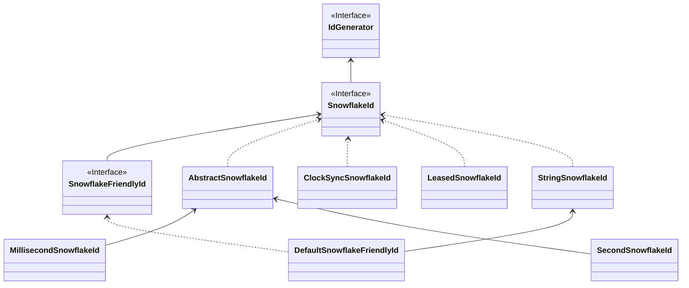

# SnowflakeId

*SnowflakeId* 把时间戳、机器号和序列号打包进一个 63 位的 `long`。只要没有两个实例同时使用同一个机器号，每个实例都可以独立生成 ID，无需调用任何存储。

<p align="center">
  
</p>

## 位布局

默认布局 `MillisecondSnowflakeId` 为 `时间戳（41 位）+ 机器号（10 位）+ 序列号（12 位）= 63 位`：

- **时间戳**：自 `epoch` 起的毫秒数。41 位约可使用 69 年。CosId 默认的 epoch 是 `1577203200000`（2019-12-24T16:00:00Z），设置更晚的 epoch 可以多用几年。
- **机器号**：10 位允许一个命名空间同时有 1024 个实例。实例如何获得机器号见[机器号](./machine-id.md)。
- **序列号**：12 位允许每个实例每毫秒生成 4096 个 ID，约每秒 400 万个。序列号用完时，生成器等待下一毫秒。

`SecondSnowflakeId`（`timestamp-unit: second`）以秒计时，默认布局为 31 + 10 + 22 位。只要三部分加起来不超过 63 位，任何布局都可以；`SnowflakeId.layout()` 返回当前布局，机器号最多 31 位。

时间戳位于高位，因此同一实例的 ID 单调递增，跨实例的 ID 趋势递增，乱序程度取决于各主机时钟的差异。

## 序列号重置

流量较低时，如果每毫秒都从 `1` 开始计数，大多数 ID 的末尾会落在少数几个值上，按 `id % n` 分片时几乎所有行都会落到同一个分片。CosId 让序列号跨毫秒继续累加，只有超过 `sequence-reset-threshold`（默认为序列号范围的一半，12 位时为 2047）后才在下一毫秒重新开始。这样低位分布更均匀，又不损失吞吐量。

## 时钟回拨

时钟回拨可能让一个实例两次生成相同的时间戳和序列号。

- **运行期间**，生成器保存上一次的时间戳，能发现时钟落后于它。开启 `clock-sync: true`（默认）时，`ClockSyncSnowflakeId` 会等待时钟追上：回拨不超过 `cosid.machine.clock-backwards.spin-threshold`（1 毫秒）时自旋等待，不超过 `broken-threshold`（500 毫秒）时休眠等待，超过则抛出 `ClockTooManyBackwardsException`。
- **重启之后**，内存中的上次时间戳已经丢失。机器号租约保存了一个*水位线*，即该机器号最后使用的时间戳，新的持有者会等到自己的时钟越过它。见[机器号](./machine-id.md#重启后的时钟回拨)。

## JavaScript 安全的 ID

JavaScript 数字只能精确表示到 2<sup>53</sup> - 1，63 位的 ID 以 JSON 数字发给浏览器会丢失低位。可以：

- 以字符串发送：使用 [ID 转换器](./id-converter.md)（`radix`、`to_string`、`snowflake_friendly`），或用 [`cosid-jackson`](../integrations/jackson.md) 处理指定字段；或
- 使用 53 位布局。`SafeJavaScriptSnowflakeId.ofMillisecond(machineId)` 创建 41 位时间戳、3 位机器号、9 位序列号的生成器；使用 Starter 时，在命名生成器上设置位数：

```yaml
cosid:
  snowflake:
    provider:
      safe-js:
        namespace: ${spring.application.name}-safe-js
        machine-bit: 3
        sequence-bit: 9
```

机器号位数越少，可用实例越少：3 位只允许 8 个。请给这类生成器单独设置 `namespace`：一个实例在每个命名空间只持有一个机器号，按 10 位租到的机器号未必放得进 3 位。

## 友好格式

`SnowflakeFriendlyId` 把 ID 格式化为 `{时间戳}-{机器号}-{序列号}`，例如 `20210623131730192-1-0`，也能解析回来。使用 Starter 时设置 `converter.type: snowflake_friendly`，时间戳按 `cosid.snowflake.zone-id` 格式化。

## 实现



| 类 | 作用 |
|----|------|
| `MillisecondSnowflakeId` | 毫秒时间戳，默认实现 |
| `SecondSnowflakeId` | 秒级时间戳 |
| `ClockSyncSnowflakeId` | 等待回拨的时钟追上（`clock-sync: true`） |
| `LeasedSnowflakeId` | 机器号租约丢失或过期后抛出 `MachineIdLostException`（`cosid.machine.guarder.fail-fast: true`） |
| `StringSnowflakeId` | `generateAsString()` 使用配置的转换器 |
| `DefaultSnowflakeFriendlyId` | 友好格式字符串 |

## 配置

Snowflake ID 需要机器号，因此要同时启用机器号：

```yaml
cosid:
  namespace: ${spring.application.name}
  machine:
    enabled: true
    distributor:
      type: redis
  snowflake:
    enabled: true
    provider:
      order:
        converter:
          type: radix
```

这会注册共享生成器（`__share__SnowflakeId`）和名为 `order` 的生成器。全部属性见 [SnowflakeId 配置](../../reference/config/snowflake.md)和[机器号配置](../../reference/config/machine.md)。
