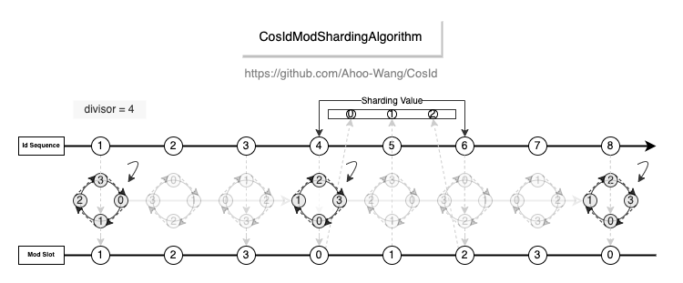

# 分片算法

`cosid-sharding` 保留了 4.x 的分片算法（D7），并随每个主版本发布。它们决定一个分片值落到哪张物理表或哪个数据库，
以及一次范围查询需要访问哪些表或库。该模块只依赖 `cosid-core`。

```kotlin
implementation("me.ahoo.cosid:cosid-sharding")
```

```java
public interface Sharding<T extends Comparable<? super T>> extends PreciseSharding<T>, RangeSharding<T> {
    String sharding(T shardingValue);                         // 一个值 → 一个节点
    Collection<String> sharding(ShardingRange<T> range);      // 一个范围 → 它涉及的节点
    Collection<String> getEffectiveNodes();
}
```

## ModCycle：取模分片

`ModCycle<T extends Number>` 将 `value mod divisor` 映射为 `{prefix}{index}`。范围只访问它覆盖的节点，
一旦跨越 `divisor` 个值，就访问全部节点。

<p align="center"></p>

```java
ModCycle<Long> orders = new ModCycle<>(4, "t_order_");
orders.sharding(10L);                                     // t_order_2
orders.sharding(ShardingRange.closed(1L, 2L));            // [t_order_1, t_order_2]
orders.sharding(ShardingRange.atLeast(0L));               // 全部四个
```

## IntervalTimeline：时间区间分片

`IntervalTimeline` 将有效时间范围按 `IntervalStep`（一个 `ChronoUnit` 加一个数量）切分为若干区间。
每个区间是一个名为 `{prefix}{suffix}` 的节点，后缀由 `DateTimeFormatter` 格式化。查找节点靠算术计算，而非搜索。

<p align="center"></p>

```java
IntervalTimeline logs = new IntervalTimeline("t_log_",
    ShardingRange.closed(LocalDateTime.of(2026, 1, 1, 0, 0), LocalDateTime.of(2026, 12, 31, 23, 59)),
    IntervalStep.of(ChronoUnit.MONTHS), DateTimeFormatter.ofPattern("yyyyMM"));
logs.sharding(LocalDateTime.of(2026, 10, 27, 12, 0));    // t_log_202610
```

有效范围之外的值会被拒绝（`IllegalArgumentException`）；有效范围之外的范围不对应任何节点。

### 转换器

区间算法对 `LocalDateTime` 分片。转换器将列值转换为 `LocalDateTime`：

| 转换器 | 接受 |
|---|---|
| `StandardLocalDateTimeConvertor(zone, isSecondTs, formatter)` | `LocalDateTime`、`ZonedDateTime`、`OffsetDateTime`、`Instant`、`LocalDate`、`Date`、`YearMonth`、`Year`、epoch `Long`（毫秒，`isSecondTs` 时为秒）、符合 formatter 格式的 `String` |
| `SnowflakeLocalDateTimeConvertor(layout, zone[, codec])` | Snowflake ID，`Long` 或文本（默认 62 进制、11 位、左侧补齐）：经 `Layout.unpack` 得到其发号时间 |

因此按月分片的表可以只用 Snowflake ID 作为键：

```java
var issued = new SnowflakeLocalDateTimeConvertor(Layout.SNOWFLAKE_MS, ZoneId.of("Asia/Shanghai"));
logs.sharding(issued.toLocalDateTime(orderId));
```

## CachedSharding

`new CachedSharding<>(sharding)` 缓存另一个算法的范围查询结果。缓存有上界：默认最多保存 10 000 个范围，满后自行清空，
因此查找不加锁。

## 与 4.x 的差异

- `ShardingRange` 取代 Guava 的 `Range`。它保留了 Guava 的工厂方法名（`closed`、`open`、`closedOpen`、
  `openClosed`、`atLeast`、`atMost`、`greaterThan`、`lessThan`、`all`、`singleton`）与语义，因此迁移只需改名。
  `BoundType` 为 `me.ahoo.cosid.sharding.BoundType`。
- `SnowflakeLocalDateTimeConvertor` 接受 `Layout` 与时区，而不是 `SnowflakeIdStateParser`。
- `cosid-sharding` 不再依赖 Guava 或 Lombok。
- ShardingSphere 自带基于 CosId 的算法；它们在 ShardingSphere 中维护，不在本项目。
