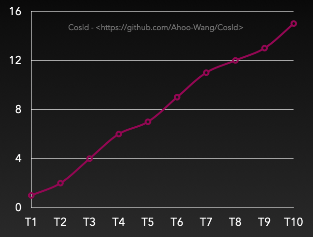
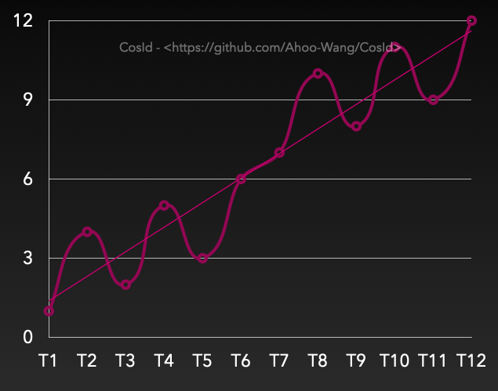

# 为什么选择 CosId

CosId 是面向 JVM 的分布式 ID 生成器：它发出的 ID 在服务的所有实例之间唯一，生成速度快到 ID 生成永远不会出现在性能剖析中，
并且形态符合应用的需要（`long`、短的 base-62 文本、可读的时间型文本、按天编号的单据号）。

本站描述的是 **CosId 5**。5.0 是一次不保留向后兼容的完全重写；离线[迁移工具](migration/from-4x.md)负责把 4.x 部署迁移过来。

## 两种唯一性来源

任何分布式 ID 的唯一性都来自以下两种原因之一，CosId 两者都提供：

| 来源 | 方式 | 协调 | CosId 策略 |
|---|---|---|---|
| **空间划分** | 把 `(time, slot, sequence)` 打包进 ID 的各个位 | 对一个槽位上一段**时间窗口**的独占租约 | `snowflake`、`cosid80` |
| **区间预留** | 从计数器原子地取出 `[start, end)`，然后在本地发放 | 每个区间一次原子自增 | `segment`、`periodic-segment` |

其余一切（编码、缓冲、重试、租约维护）都是 `cosid-core` 中的本地代码。存储只需实现两个原语：`RangeStore.reserve` 和
`SlotLeaseStore` 的三个操作，并由同一套测试（TCK）以同样的方式验证每个存储。

## 可以选择什么

| 需求 | 使用 |
|---|---|
| 可排序的 63 位 ID，每个 ID 无需访问存储 | 基于租用（或静态）机器号槽位的 `snowflake` |
| JavaScript 客户端能以数字形式持有的 ID | `snowflake` 加 `layout: JS_SAFE_MS`（53 位） |
| 每个 key 短而稠密、严格递增的 ID | `segment` |
| 每年、每月或每天重新开始的编号（`20261027-000042`） | `periodic-segment` |
| 超过 64 位，以文本形式 | `cosid80`（44 位毫秒、20 位节点、16 位序列） |
| 给不在 JVM 上或无法访问存储的客户端使用的 ID | [cosid-server](server.md) 的可选发号端点 |

各自的配置见 [ID 配方](recipes.md)。

## 5.0 的保证

- **唯一性不依赖任何时钟。** 机器号槽位以时间窗口 `(floor, ceiling]` 的形式租用；存储维护
  `next floor ≥ previous ceiling`，生成器绝不发出窗口之外的时间戳。时钟只决定租约*何时*过期，这只影响可用性。
  见[槽位租约](concepts/slot-lease.md)。
- **允许间隙，绝不重复。** 所有失败路径（超时、崩溃、丢弃的区间）都只会丢失 ID。
- **没有全局状态。** 时间源、执行器、监听器与存储都通过注入提供；一个 JVM 可以运行多个相互独立的运行时。
- **性能与特性均不低于 4.x**（D21）：每项 4.x 能力在 5.0 中都有对应，每个基准场景都与 4.1.0 对比，作为发布门槛
  （[基准测试](../reference/performance/benchmark.md)）。

## ID 方案的核心指标

- 业务 key 内的**唯一性**是唯一不能妥协的属性。
- **有序性**：ID 递增时 B+ 树索引的追加代价很低；随机 ID 会导致页分裂。Snowflake ID 是趋势递增的
  （跨实例按时间递增）；号段在单个实例内严格递增。
- **吞吐与稳定性**：每次写入都要生成 ID，因此速率和尾延迟（p99、p99.9）都很重要。CosId 让锁和 I/O 远离热路径。
- **自治与可用性**：号段需要存储来补充（预取可以掩盖这一点），Snowflake 需要续约槽位租约（每 `ttl/3` 一次写入）
  以及一个正常的时钟。

  

  

## 模块

| Artifact | 内容 |
|---|---|
| `cosid-core` | 生成器、编解码器、租约、`CosIdRuntime`、`@CosId` 字段填充；只依赖 `slf4j-api` |
| `cosid-store-jdbc`、`-redis`、`-mongo`、`-zookeeper`、`-remote` | 各存储 |
| `cosid-spring-boot-starter` | Spring Boot（core + autoconfigure）；自行添加所用的存储 artifact |
| `cosid-jackson`、`cosid-mybatis`、`cosid-spring-data-jdbc`、`cosid-activiti`、`cosid-flowable`、`cosid-axon` | 各集成，每个三方库一个 artifact（D29） |
| `cosid-sharding` | 分片算法（`ModCycle`、`IntervalTimeline`） |
| `cosid-store-tck` | 存储契约与一个内存存储，用于测试 |
| `cosid-bom` | 以上所有 artifact 的版本 |
| cosid-server（Docker 镜像） | 远程存储服务；见 [cosid-server](server.md) |
| `cosid-migration.jar` | 离线 4.x → 5.0 迁移工具 |
